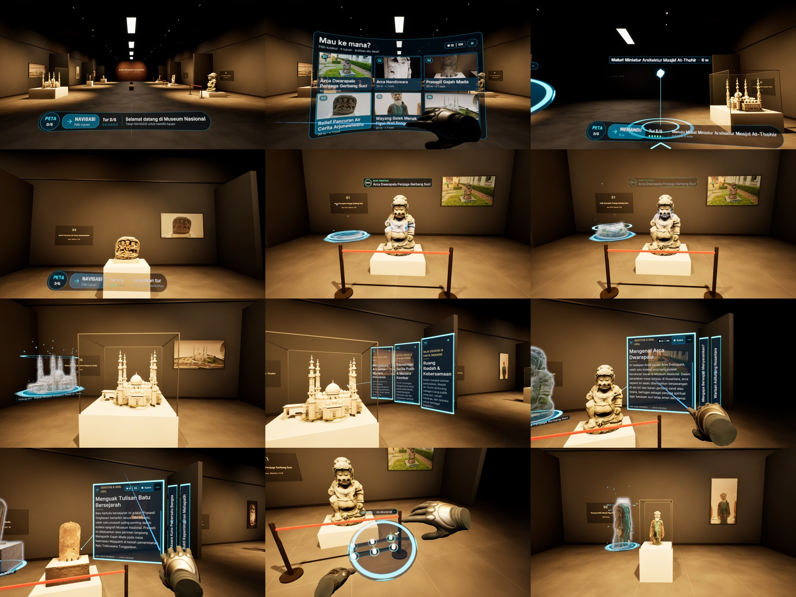
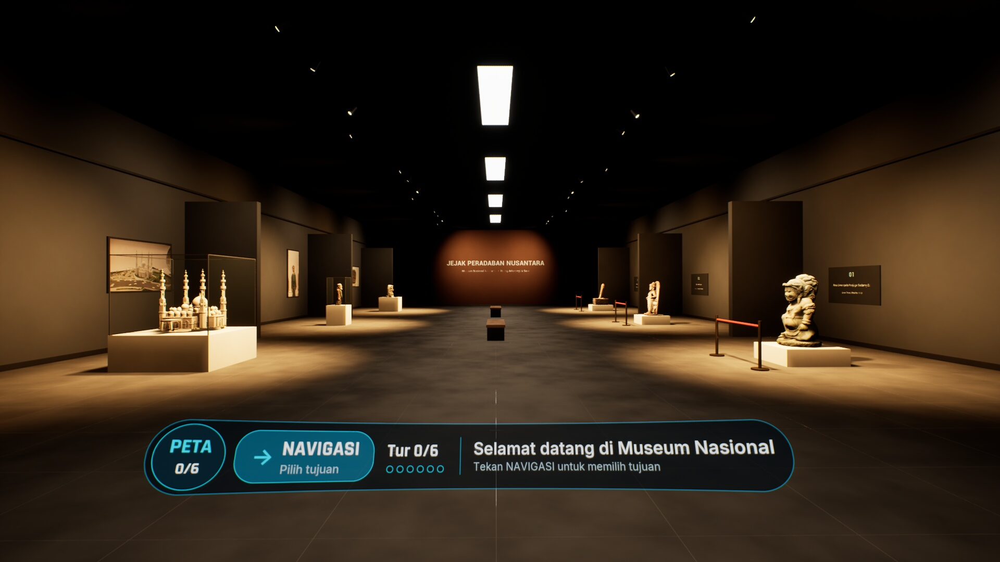
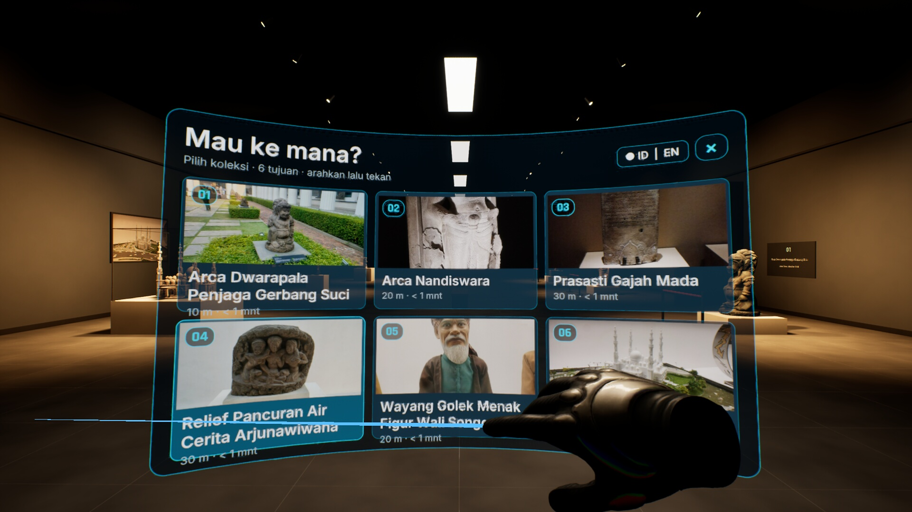
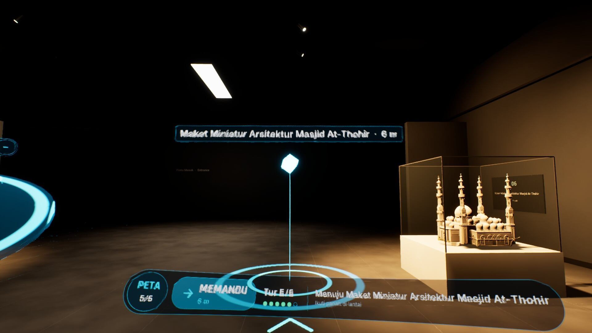
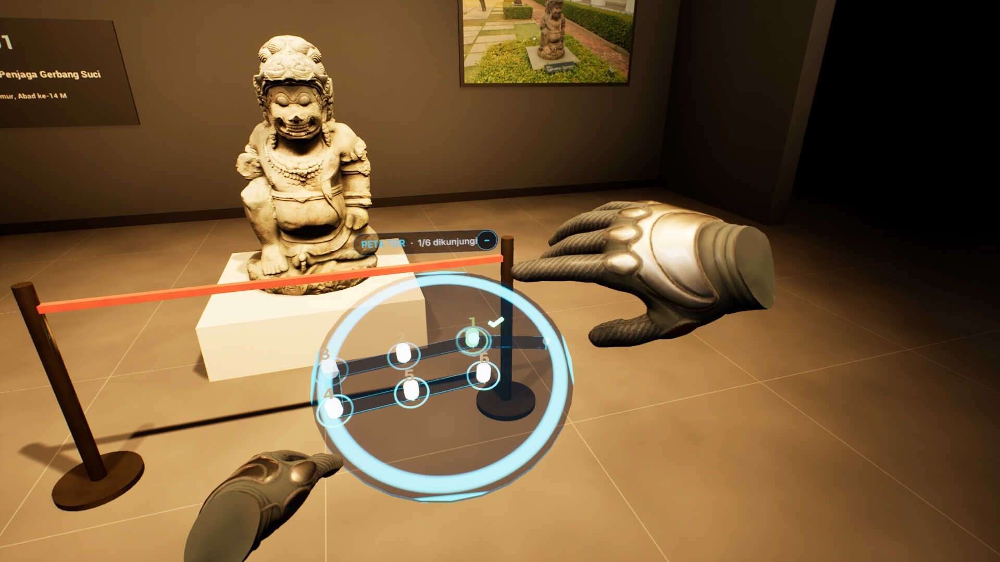
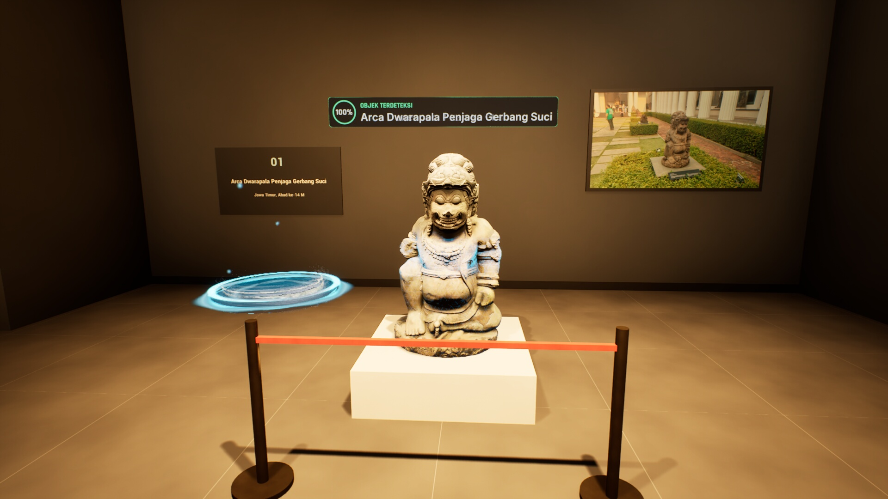
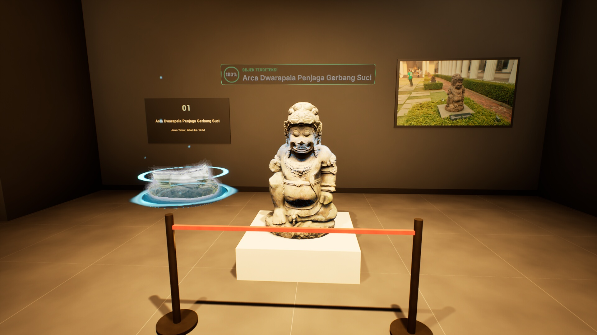
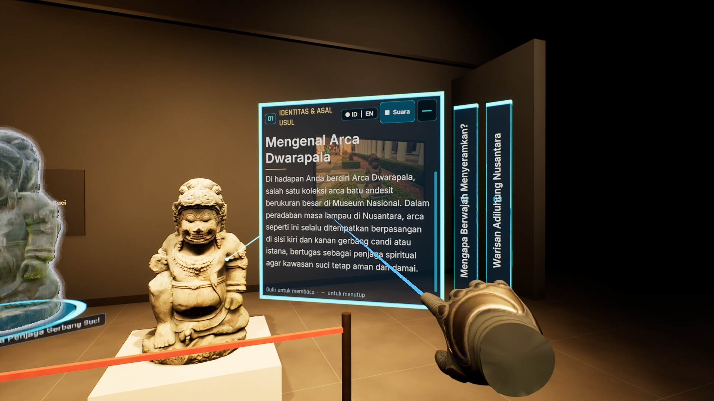
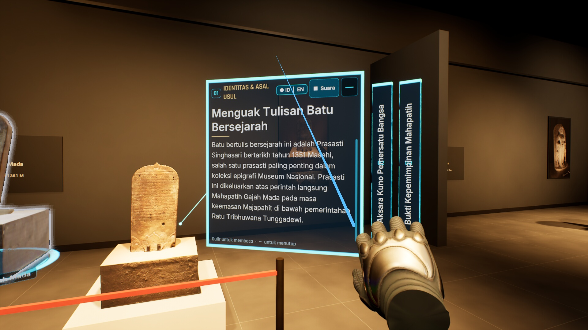

# VRfly – Museum Nasional VR/MR Exhibit

**A VR / mixed-reality guided tour of six collection objects from Museum Nasional Indonesia, built in Unreal Engine 5.8 with C++ for Meta Quest (OpenXR).**
Self-initiated project by **Eka Putra Meravigliosi** ([@EkaPutra0856](https://github.com/EkaPutra0856)): concept, level design, programming, 3D capture of the objects, UI and the VRfly proposal.

The visitor walks a gallery, picks a destination, follows a floor route to the object, and the headset "detects" it: a 3D scan sweeps over the real object, a hologram twin builds up beside it, and story cards open around it with a voice guide in Indonesian or English.

> **Demo video (7:45, with voice guide) and proposal deck:** [Google Drive](https://drive.google.com/drive/folders/16PTlVYvoA6fdBFqprP_F2l86mJYbjqKe)



---

## Highlights

- **Two demo maps, one MR layer.** `L_MuseumGallery`: a lit 3D gallery with all six objects at real scale. `L_MuseumDemo`: the same layer composited over real footage shot in the museum, styled as a Quest passthrough view.
- **Six real collection objects**, captured on site (photos + video) and turned into textured 3D models with Tripo: Arca Dwarapala, Arca Nandiswara, Prasasti Gajah Mada (1351), Relief Pancuran Arjunawiwaha, Wayang Golek Wali Songo, Maket Masjid At-Thohir.
- **Guidance:** destination menu, dotted floor route with a distance pin, and a clickable 3D diorama minimap that rotates 360°.
- **Interaction:** headset object detection, hologram twins, perspective info cards (expand / minimise / scroll), video card with a large theatre screen, ID/EN language toggle that switches both text and voice.
- **All gameplay and UI in C++** (~12k lines in the game module; the MR widgets are built in C++), plus ~3.4k lines of Python editor tooling that builds the levels and records the demo headlessly.
- **Storyboard-first process:** eight storyboard frames were painted over real footage before any Unreal work, then each feature was checked against them.

---

## Level Design

### Tour route that follows the collection order
The gallery (43 x 19 m, 6 m ceiling) is laid out as one loop that matches the tour order 01 to 06:

| Stop | Object | Placement |
|---|---|---|
| 01 | Arca Dwarapala (gate guardian) | Left wall, first bay, rope barrier |
| 02 | Arca Nandiswara (Shiva temple guardian) | Left wall, rope barrier |
| 03 | Prasasti Gajah Mada, 1351 | Left wall, rope barrier |
| 04 | Relief Pancuran Arjunawiwaha | Right wall |
| 05 | Wayang Golek Wali Songo | Right wall, glass vitrine |
| 06 | Maket Masjid At-Thohir | Right wall, glass vitrine |

Objects 01–03 sit on the left wall and 04–06 on the right, so the route turns once at the end wall (titled *"Jejak Peradaban Nusantara"*) and never crosses itself. Visitors finish near where they started.

### Viewing spots and spacing
- **Real scale.** Each object is placed at its real size (for example Dwarapala 150 cm, relief 75 cm, mosque model 150 cm wide) and faces the visitor's approach.
- **One bay per object.** Wall fins split the hall into bays, so only one object is in view at a time. Each bay has a plinth, a wall plaque (number, name, origin), a framed documentation photo, and its own track lighting (key + fill at 3100 K, washers on the plaque and photo).
- **A defined viewing spot per object** (station, zone and gaze target). Holograms and cards are placed by **angle from the visitor's eye**, not by fixed world offsets. Cards stay at least 2.5° away from the object and from each other, so they never cover the real object.
- **Free side for overlays.** Cards use the side of the object that is empty: beside it, above it, or below the hologram label. The front map opens on that free side too.

### VR comfort
- Head-relative walking and **45° snap turn** (no smooth rotation).
- Eye height fixed at 165 cm. Panels use lazy-follow instead of being head-locked.
- HUD bar curves low, below the line of sight. It hides while a menu, the front map or an object presentation is open.
- The large video screen spans 70% of the view at 150 cm, with its pitch clamped to ±12°. The minimap tilts only slightly.
- The detection effect was toned down after review: a short 3D scan band over the object, with no full-screen glitch or darkening.
- The laser pointer appears only over panels, holograms and the open map, so it does not clutter the view.



---

## Guidance

- **"Mau ke mana?" (Where to?) menu.** A curved 3D glass menu with six cards: thumbnail, number, distance, and a "visited" check.
- **Floor waypoints.** Glowing dots every 50 cm (every third dot is an arrow), with a light wave running toward the target. At the destination: a floor ring, a light beam and a floating pin labelled with name and distance (for example "Arca Dwarapala · 11 m"). The pin scales up with distance so it stays readable.
- **3D diorama minimap.** A tilted glass tray holding a miniature of the gallery. Each stop has a 6 cm miniature of its artifact, a number and a "visited" tick.
  - Hover scales up and glows a stop. A click asks "Start navigation to this destination?"
  - After **Yes**, the route draws itself from the visitor to the stop in 1.4 s.
  - Hold the trigger and drag to rotate the map 360°.
  - It shows "You are here" and the tour progress (n/6).
  - While guiding, the map docks to the side. It opens like a table model in front when requested.
- **Tour progress.** A visit counts once all three story cards have been heard, so 6/6 means the full content was seen.





---

## Interaction

1. **Object detection by headset.** When the visitor reaches the viewing spot, a label goes from "SCANNING…" to "OBJECT DETECTED · name" with a progress ring. A scan shell of the real object shows a cyan band rising from base to top, with a triangle grid and rim glow.
2. **Hologram twin.** A translucent cyan-gold copy builds from bottom to top on a glass pedestal beside the real object. It glows while the guide speaks and turns on a turntable otherwise.
3. **Perspective info cards.** Three story cards and one video card per object. Each card is a 3D glass panel in the scene's perspective, not a flat sticker.
   - One card opens at a time; the others shrink to slim bars with a "+" button.
   - Text scrolls. Cards 2–3 add a supporting photo.
   - The voice guide reads the open card.
4. **Video card and theatre screen.** Play/pause in the card. **Enlarge** opens a big 3D screen; the other cards fade while it is open.
5. **ID / EN toggle.** Indonesian by default. One button in the menu or on a card switches all text and the voice-over clip.






---

## Technical Overview

| Area | Folder | What it does |
|---|---|---|
| VR | `Source/Museum/VR` | Laser pointer, hover/click on world widgets, snap turn, lazy-follow panel host, demo autopilot (`MuseumVRDemoDirector`) |
| MR layer | `Source/Museum/MR` | Curved HUD bar, destination menu, info cards, 3D minimap, floor waypoints, labels, shared style |
| Exhibit | `Source/Museum/Exhibit` | Per-object data asset, detection, card layout by view angle, voice-over, video screen |
| Hologram | `Source/Museum/Hologram` | Static-mesh hologram reveal, scan ring, speaking glow |
| Passthrough | `Source/Museum/Passthrough` | Video plates stabilised to each object, passthrough look (grain, desaturation, vignette) |
| Language | `Source/Museum/Language` | ID/EN subsystem used by every widget and voice-over |
| UI | `Source/Museum/UI` | Path-guide controller, tour tracker, view-clutter control |
| Plugin | `Plugins/WzSystem` | Reusable interaction, MVC-style UI, narrative and path-guide systems |
| Tools | `Tools/` | Python: import exhibits, build both levels, prepare/stabilise video, build demo scripts, render MP4, mix the voice-over track |

**Demo recording pipeline.** A JSON script drives the real Quest inputs (walk, snap turn, trigger, scroll) through the autopilot, so the video shows the actual features. The run is rendered to MP4, and voice-over cues logged in-game are mixed into the audio track.

**Built with:** Unreal Engine 5.8, C++, OpenXR / OculusXR, Enhanced Input, Media Framework, Nanite, Python editor scripting, ffmpeg. Storyboard frames made with Gemini.

---

## Repository Contents

This repository holds source code, config, tools and docs only. Binary assets are not included: the 3D models, footage, textures and audio (~1 GB in `Content/`). The demo video and the proposal deck are on [Google Drive](https://drive.google.com/drive/folders/16PTlVYvoA6fdBFqprP_F2l86mJYbjqKe).

```
Museum.uproject
Source/Museum/          C++ game module
Plugins/WzSystem/       plugin source (+ small content)
Config/                 project config
Tools/                  Python / batch editor and demo tooling
Docs/                   plan, storyboard, change log, screenshots
```

**Requirements to build:** Unreal Engine 5.8 and a C++ toolchain supported by it. Generate project files from `Museum.uproject`, then build the `MuseumEditor` target. The maps need the excluded `Content/` assets to run.

**Tool environment variables:** `UE_ROOT` (Unreal Engine install folder, used by `Tools/Demo/run_demo.cmd` and `Tools/Editor/run_py.ps1`), `FFMPEG` (optional, defaults to `ffmpeg` on PATH), `GEMINI_API_KEY` (storyboard scripts only), `ZOO_CONTENT` (only for `Tools/Assets/zoo_asset_closure.py`).

---

## Status and Next Steps

- Desktop demo recorded (gallery map, 7:45, with ID/EN voice guide).
- Proposed rollout: VR corners per museum zone first. Real MR passthrough on Quest, screen casting and Android come later.
- To do: Quest build (decimated meshes, 2K textures) and real-world anchoring for MR.

---

*Object photos, video footage and 3D captures were made by the author at Museum Nasional Indonesia. This is an independent concept project; it is not affiliated with or endorsed by the museum.*
